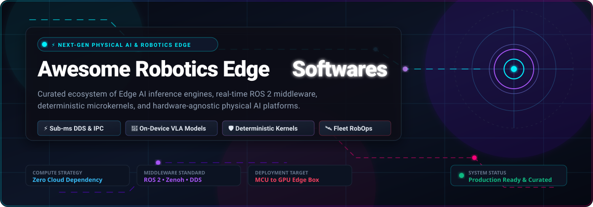

<p align="center">
  
</p>

<p align="center">
  <a href="https://github.com/ishandutta2007/Awssome-Awesome-Awesome"></a><a href="htpps/://discord.gg/jc4xtF58Ve"></a>
  <a href="https://github.com/ishandutta2007/Awesome-Robotics-Edge-Softwares/stargazers"></a>
  <a href="https://github.com/ishandutta2007/Awesome-Robotics-Edge-Softwares/network/members"></a>
  <a href="https://opensource.org/licenses/MIT"></a>
  <a href="CONTRIBUTING.md"></a>
  <a href="https://github.com/ishandutta2007"></a>
</p>

# 🤖 Awesome Robotics Edge Softwares

> 🚀 **A curated directory of top SaaS platforms and open-source GitHub projects powering the next generation of Robotics Edge Software, Physical AI, and Real-Time Autonomous Systems.**

**Focused on Edge AI Inference, Microsecond DDS Middleware, Deterministic Control Loops & Hardware-Agnostic Fleet Deployment.**

---

## 📑 Table of Contents

- [🌐 What is Robotics Edge Software?](#-what-is-robotics-edge-software)
- [📊 Sector Overview & Market Dynamics](#-sector-overview--market-dynamics)
- [💼 SaaS & Commercial Hosted Platforms](#-saas--commercial-hosted-platforms)
- [⭐ Open-Source GitHub Projects](#-open-source-github-projects)
  - [🏆 Ranked Open-Source Repositories (by Stars)](#-ranked-open-source-repositories-by-stars)
  - [📦 Specialized Python Edge Runtimes & Frameworks](#-specialized-python-edge-runtimes--frameworks)
- [🧩 Architecture Stack Comparison](#-architecture-stack-comparison)
- [🔍 SEO & Industry Keywords](#-seo--industry-keywords)
- [🤝 How to Contribute](#-how-to-contribute)
- [☕ Support](#-support)
- [📈 Star History](#--star-history)
- [⚖️ Disclaimer & Safety Standards](#️-disclaimer--safety-standards)

---

## 🌐 What is Robotics Edge Software?

**Robotics Edge Software** encompasses the localized operating systems, communication middleware, model execution runtimes, and fleet telemetry daemons that execute **directly on embedded robot compute hardware** (e.g., NVIDIA Jetson, Raspberry Pi, industrial IPCs, x86 ECUs, and microcontrollers). 

### 🎯 Key Architectural Pillars
- **⚡ Sub-Millisecond Deterministic Latency**: Executes critical feedback control loops (100 Hz to 1 kHz+) on local hardware without incurring cloud round-trip lag.
- **🧠 On-Device Physical AI & VLA Inference**: Runs Vision-Language-Action (VLA) models, LiDAR SLAM, object detection, and spatial depth perception locally via INT8/FP16 quantized neural nets.
- **🛰️ Cloud-Disconnected Autonomous Survivability**: Guarantees fail-safe operational continuity during complete wireless/cloud network dropouts.
- **🔒 Bandwidth Optimization & Security**: Curates, compresses, and filters multi-gigabyte raw sensor streams before transmitting actionable event triggers to cloud telemetry backends.

---

## 📊 Sector Overview & Market Dynamics

The global **Edge AI Software and Robotics Edge ecosystem** is valued at approximately **$3.1 Billion to $14.5 Billion in 2026** and is projected to expand dynamically at a **Compound Annual Growth Rate (CAGR) of ~28% to 34%**, exceeding **$19.7 Billion by 2030 and $51.8 Billion by 2033** as physical AI, autonomous mobile robots (AMRs), and humanoid robotics scale into manufacturing, warehousing, and field operations.

### 🧩 Market Fragmentation vs. Concentration
The robotics edge sector is currently **moderately to highly fragmented** rather than a winner-take-all monopoly:
- **Hyperscaler Layer (Concentrated Infrastructure)**: Cloud giants (e.g., AWS IoT Greengrass) and silicon leaders (e.g., NVIDIA Isaac OS & JetPack) hold strong concentration in underlying edge runtimes, hardware acceleration, and global telemetry piping.
- **Operational & Runtime Layer (Highly Fragmented)**: Due to extreme heterogeneity across robot form factors (quadrupeds, wheeled AMRs, robotic arms, submersibles), specialized safety certifications (ISO 26262, IEC 61508), hard real-time timing deadlines (DDS, TSN, RT-Preempt), and varied sensor payloads, the application layer remains decentralized. This gives rise to specialized, high-growth contenders across deterministic microkernels, fleet observability, and multi-tenant robot operations (RobOps).

---

## 💼 SaaS & Commercial Hosted Platforms

The table below lists leading commercial SaaS and enterprise-supported platforms designed for robotics edge computing, model deployment, and fleet operations.

> **Sorted by Company Scale (Valuation / Revenue) in Descending Order.**

| # | 🏢 Platform / Product | 📈 Company Scale (Valuation / Revenue) | 🏷️ Starting Tier Pricing | 🎁 Free Tier / Evaluation Limits | 🛠️ Primary Edge Capabilities |
|---|----------------------|----------------------------------------|---------------------------|----------------------------------|------------------------------|
| 1 | **[NVIDIA Isaac OS](https://developer.nvidia.com/isaac)** | **~$3.0 Trillion** (Market Cap) / $120B+ Revenue | **$4,500 / GPU / year** *(NVIDIA AI Enterprise production)* or **$1.00 / GPU-hour** on cloud | **Free forever** for local development, academic research, and evaluation on Jetson & workstations (up to 2 users; includes Isaac ROS, JetPack & Isaac Lab) | Edge AI OS layer with hardware-accelerated perception, VLA model deployment, Isaac ROS packages, and Omniverse digital twin simulation. |
| 2 | **[AWS IoT Greengrass](https://aws.amazon.com/greengrass/)** | **~$2.1 Trillion** (Market Cap) / $105B+ AWS Run-Rate | **$0.16 / active core device / month** *(+ $1.00 per 1M MQTT messages via IoT Core)* | **12-Month Free Tier: First 3 core devices free per month** for the first year (unlimited local component and Lambda executions on edge) | Extends AWS compute and ML inference directly to edge devices; manages local container components, MQTT pub/sub, and shadow synchronization. |
| 3 | **[Canonical Ubuntu Core](https://ubuntu.com/core)** | **~$3.0 Billion** (Valuation) / $251M Revenue | **$25.00 / device / year** *(~$2.08 / device / month on Ubuntu Pro for Devices)* | **Free forever for up to 5 devices** (physical machines, VMs, or IoT edge boards) with a free personal Ubuntu Pro token | Transactional, immutable snap-based Linux OS designed for autonomous robots; features atomic over-the-air (OTA) updates, automated rollbacks, and strict confinement. |
| 4 | **[Viam Robotics Platform](https://www.viam.com/)** | **~$650 Million** (Valuation, $112M+ funding) | **$0.0003 / min** data capture + **$2.50 / GB / mo** cloud storage + **$0.15 / GB** sync *(Pay-as-you-go)* | **$5.00 free cloud credits every month forever** (unrestricted open-source `viam-server` RDK runtime on local devices; $30,000 startup program available) | Hardware abstraction layer (RDK) for multi-vendor hardware, live sensor streaming, edge machine learning deployment, and cloud-to-edge synchronization. |
| 5 | **[ADLINK Edge & Neuron SDK](https://www.adlinktech.com/)** | **~$540 Million** (Market Cap: 6166.TW) / $380M Revenue | **$150.00 / node one-time license** *(or bundled with ROScube hardware starting at $1,200)* | **30-day full-feature evaluation license** (covers ADLINK Edge SDK, Neuron SDK, and Data River connectors upon registration) | Industrial edge IoT data river, hardware-accelerated ROS 2 / DDS edge compute, deterministic machine vision, and AMR fleet controllers. |
| 6 | **[Edge Impulse](https://www.edgeimpulse.com/)** | **~$250 Million** (Valuation, $45M Series B) | **$0.00 / month** *(Developer Plan)*; Enterprise contracts start at **$3,000 / month** *(AWS Marketplace private offer)* | **Free forever on Developer Plan**: includes up to 3 private projects, 60-min GPU training job runtime, 3 team collaborators, and EON compiler optimization | End-to-end edge AI platform for training, quantizing, and deploying real-time vision, sensor fusion, and audio models to microcontrollers and edge processors. |
| 7 | **[Formant RobOps Platform](https://formant.io/)** | **~$220 Million** (Valuation, $62M funding) | **$10.00 / device / month** *(Starter Plan)* or $250.00 / device / month for enterprise high-bandwidth teleoperation | **Free forever for up to 2 active robots** with real-time telemetry, basic teleoperation, and ROS 1/2 topic streaming (no credit card required) | Unified robot operations (RobOps) platform providing sub-second teleoperation, fleet health observability, ROS bag recording, and automated incident triage. |
| 8 | **[Balena (balenaCloud)](https://www.balena.io/)** | **~$120 Million** (Valuation, ~$18M Revenue) | **$159.00 / month** *(Prototype Plan: includes 30 devices; additional devices at $3.00 / device / month)* | **Free forever for your first 10 devices** across all fleets with full microservices container engine and remote CLI access | Container-based edge device fleet management with delta OTA updates, remote SSH access, public device URLs, and multi-container Docker Compose orchestration. |
| 9 | **[Foxglove Studio & Platform](https://foxglove.dev/)** | **~$100 Million** (Valuation, $18M Series A) | **$20.00 / month** *(Pro Plan: includes 3 dev seats, 1 TB cloud storage, unlimited basic viewers; $0.05/GB overage)* | **Free forever**: includes up to 3 developer seats, 5 connected devices, 10 GB cloud storage, and 1 project workspace (unlimited local MCAP playback) | Advanced visualization and observability platform for robotics; features live WebSocket robot streaming, 3D point-cloud inspection, and MCAP data curation. |
| 10 | **[Hivecell Edge Platform](https://hivecell.com/)** | **~$25 Million** (Valuation, $7M funding) | **$625.00 / node / month** *($7,500 / node / year bundled Edge-as-a-Service hardware + software)* | **30-day proof-of-concept (PoC) evaluation trial** (includes 1 managed node loaner and remote orchestration dashboard) | Turnkey modular Edge-as-a-Service clusters offering zero-touch deployment and containerized microservice execution directly at industrial facilities. |
| 11 | **[eProsima Commercial Suite](https://www.eprosima.com/)** | **~$20 Million** (Valuation, ~$5M Revenue) | **$5,000 / year flat subscription** *(Fast DDS Pro with unlimited node runtime deployments and zero royalties)* | **Free forever open-source core** (Apache 2.0 license) + **30-day free trial** of commercial enterprise plugins (TSN, low-bandwidth, and security plugins) | Enterprise-grade DDS & Micro XRCE-DDS middleware powering ROS 2 default communications with TSN time-sensitive networking and sub-microsecond latency. |
| 12 | **[NEPI by Numurus](https://numurus.com/)** | **~$15 Million** (Valuation, ~$3M Revenue) | **$100.00 / device one-time commercial license** *(or $20,000 / year volume enterprise subscription)* | **Free forever for prototyping & R&D** via NEPI Docker Lite / source-available license (unlimited evaluation duration on Linux/Jetson hardware) | Source-available ROS/ROS 2 edge AI operating environment with turnkey sensor drivers (cameras, LiDAR, sonar), AI inference managers, and web GUI. |

---

## ⭐ Open-Source GitHub Projects

Explore the open-source software driving autonomous edge intelligence. Every project below includes its live GitHub star count badge linking directly to the repository's stargazers page.

### 🏆 Ranked Open-Source Repositories (by Stars)

> **Sorted strictly by GitHub Star Count in Descending Order.**

1. 🤖 **[LeRobot](https://github.com/huggingface/lerobot)** [](https://github.com/huggingface/lerobot/stargazers)  
   Hugging Face's state-of-the-art PyTorch library for physical AI and real-world robotics. Supplies pretrained Vision-Language-Action (VLA) weights, imitation learning pipelines, and edge inference optimization on real robotic arms and mobile manipulators.

2. 🚗 **[Apollo](https://github.com/ApolloAuto/apollo)** [](https://github.com/ApolloAuto/apollo/stargazers)  
   Baidu's open autonomous driving platform featuring Cyber RT — a high-performance, deterministic edge runtime specifically engineered for autonomous vehicles with microsecond IPC scheduling.

3. 🚙 **[Autoware](https://github.com/autowarefoundation/autoware)** [](https://github.com/autowarefoundation/autoware/stargazers)  
   The premier open-source autonomous driving software stack built natively on ROS 2. Provides modular 3D perception, NDT LiDAR localization, rule-based/ML planning, and vehicle drive-by-wire edge control.

4. 📷 **[librealsense](https://github.com/IntelRealSense/librealsense)** [](https://github.com/IntelRealSense/librealsense/stargazers)  
   Intel's cross-platform open-source library and driver stack for RealSense D400 and LiDAR L500 depth cameras, powering embedded 3D spatial edge perception.

5. ⚡ **[jetson-inference](https://github.com/dusty-nv/jetson-inference)** [](https://github.com/dusty-nv/jetson-inference/stargazers)  
   Guide and library for deploying deep learning inference networks (TensorRT) and real-time computer vision DNNs to NVIDIA Jetson edge robotics devices.

6. 🐳 **[jetson-containers](https://github.com/dusty-nv/jetson-containers)** [](https://github.com/dusty-nv/jetson-containers/stargazers)  
   Modular Docker container runtime builds for deploying PyTorch, ONNX Runtime, TensorRT-LLM, and ROS 2 seamlessly onto NVIDIA Jetson edge systems.

7. 🗺️ **[Navigation2 (Nav2)](https://github.com/ros-planning/navigation2)** [](https://github.com/ros-planning/navigation2/stargazers)  
   The industry-standard autonomous mobile robot (AMR) navigation stack for ROS 2. Implements behavior-tree orchestration, dynamic costmaps, obstacle avoidance, and path-tracking controllers at the edge.

8. 🌊 **[Dora (dora-rs)](https://github.com/dora-rs/dora)** [](https://github.com/dora-rs/dora/stargazers)  
   Ultra-fast robotics dataflow framework and distributed orchestrator written in Rust. Features zero-copy shared-memory transport and columnar memory layouts (Apache Arrow) for minimal latency on massive edge vision payloads.

9. ⚡ **[Zenoh](https://github.com/eclipse-zenoh/zenoh)** [](https://github.com/eclipse-zenoh/zenoh/stargazers)  
   Zero-overhead Pub/Sub/Query communication protocol and middleware by Eclipse. Unifies data in motion, data at rest, and compute from microcontrollers to edge gateways and cloud brokers with minimal network overhead.

10. 🔌 **[Fast DDS](https://github.com/eProsima/Fast-DDS)** [](https://github.com/eProsima/Fast-DDS/stargazers)  
    High-performance Data Distribution Service (OMG DDS 1.4) implementation in C++. Default middleware for ROS 2 delivering predictable, deterministic sub-millisecond inter-process and network messaging.

11. 🌪️ **[Eclipse Cyclone DDS](https://github.com/eclipse-cyclonedds/cyclonedds)** [](https://github.com/eclipse-cyclonedds/cyclonedds/stargazers)  
    Ultra-reliable, high-throughput OMG DDS implementation optimized for mission-critical robotic systems and automotive edge controllers.

12. 📼 **[MCAP](https://github.com/foxglove/mcap)** [](https://github.com/foxglove/mcap/stargazers)  
    High-performance, modular container file format developed by Foxglove for logging multi-gigabyte heterogeneous robotics data directly on edge devices without re-serialization bottlenecks.

13. 🐕 **[unitree_ros2](https://github.com/unitreerobotics/unitree_ros2)** [](https://github.com/unitreerobotics/unitree_ros2/stargazers)  
    ROS 2 hardware interface and low-level motor communication stack for Unitree quadrupedal robots (Go2, B2) and humanoid platforms (H1, G1) operating at the edge.

14. 🦾 **[Universal Robots ROS 2 Driver](https://github.com/UniversalRobots/Universal_Robots_ROS2_Driver)** [](https://github.com/UniversalRobots/Universal_Robots_ROS2_Driver/stargazers)  
    Official industrial ROS 2 edge control driver for Universal Robots cobots (UR3e, UR5e, UR10e, UR20, UR30), enabling real-time velocity/position control and trajectory execution.

15. 💻 **[rclcpp](https://github.com/ros2/rclcpp)** [](https://github.com/ros2/rclcpp/stargazers)  
    Official ROS 2 C++ client library providing executors, callback groups, intra-process zero-copy communication, and lifecycle nodes for low-latency edge computing.

16. 🏭 **[openTCS](https://github.com/openTCS/opentcs)** [](https://github.com/openTCS/opentcs/stargazers)  
    Flexible, platform-independent transport control system designed for managing and orchestrating fleets of autonomous guided vehicles (AGVs) and mobile robots.

17. 🎛️ **[micro_ros_arduino](https://github.com/micro-ROS/micro_ros_arduino)** [](https://github.com/micro-ROS/micro_ros_arduino/stargazers)  
    Pre-compiled Micro-ROS library for the Arduino IDE and PlatformIO, bringing native ROS 2 publisher/subscriber nodes directly into embedded microcontroller boards (Teensy, ESP32, STM32).

18. 🛠️ **[micro_ros_setup](https://github.com/micro-ROS/micro_ros_setup)** [](https://github.com/micro-ROS/micro_ros_setup/stargazers)  
    Build system and cross-compilation toolchain for deploying Micro-ROS client layers across microcontrollers running FreeRTOS, Zephyr, and NuttX.

19. 💻 **[balena-cli](https://github.com/balena-io/balena-cli)** [](https://github.com/balena-io/balena-cli/stargazers)  
    Official command-line interface for the Balena platform, managing edge device fleets, local development mode, and container deployment pipelines.

20. 🐍 **[rclpy](https://github.com/ros2/rclpy)** [](https://github.com/ros2/rclpy/stargazers)  
    Official ROS 2 Python client library enabling rapid development of edge perception, model integration, and robot control nodes.

21. 🏢 **[Open-RMF](https://github.com/open-rmf/rmf)** [](https://github.com/open-rmf/rmf/stargazers)  
    Open Robot Management Framework for coordinating heterogeneous robot fleets, automated doors, and elevators in shared physical environments.

22. ⚡ **[HORUS](https://github.com/softmata/horus)** [](https://github.com/softmata/horus/stargazers)  
    Ultra-low latency robotics framework implemented in Rust with Python bindings. Achieves **87ns IPC latency and 12M+ messages/second throughput** using zero-copy shared memory transport and deadline-driven priority scheduling.

23. 🩺 **[ros2_medkit](https://github.com/selfpatch/ros2_medkit)** [](https://github.com/selfpatch/ros2_medkit/stargazers)  
    Structured fault management and health monitoring system for ROS 2 with persistent fault lifecycles, REST/SSE APIs, and automated root cause isolation.

24. 📡 **[Micro XRCE-DDS](https://github.com/eProsima/Micro-XRCE-DDS)** [](https://github.com/eProsima/Micro-XRCE-DDS/stargazers)  
    Lightweight client-agent middleware implementing the OMG DDS-XRCE standard, enabling extremely resource-constrained microcontrollers to publish into standard DDS data spaces.

25. 🤖 **[micro-ROS-Agent](https://github.com/micro-ROS/micro-ROS-Agent)** [](https://github.com/micro-ROS/micro-ROS-Agent/stargazers)  
    ROS 2 node that bridges Micro-ROS client microcontrollers to the wider ROS 2 DDS network over serial, UDP, or CAN interfaces.

26. 🔧 **[viam-server (RDK)](https://github.com/viamrobotics/rdk)** [](https://github.com/viamrobotics/rdk/stargazers)  
    The open-source Robot Development Kit (RDK) core written in Go. Manages local hardware abstraction, sensor readings, motor commands, and gRPC communication interfaces.

27. 🧪 **[action-ros-ci](https://github.com/ros-tooling/action-ros-ci)** [](https://github.com/ros-tooling/action-ros-ci/stargazers)  
    GitHub Actions workflow for continuous integration and automated testing of ROS and ROS 2 packages across multiple distributions.

28. ☁️ **[aws-greengrass-nucleus](https://github.com/aws-greengrass/aws-greengrass-nucleus)** [](https://github.com/aws-greengrass/aws-greengrass-nucleus/stargazers)  
    Core open-source software that runs on an edge device to manage Greengrass components, configuration updates, and life-cycle synchronization.

29. 🛡️ **[SROS2](https://github.com/ros2/sros2)** [](https://github.com/ros2/sros2/stargazers)  
    Security extensions for ROS 2 providing automated certificate generation, access control policies, and DDS-Security encryption for edge nodes.

30. 📊 **[Foxglove Studio](https://github.com/foxglove/studio)** [](https://github.com/foxglove/studio/stargazers)  
    Open components and extension ecosystem for Foxglove Studio, facilitating custom robotics panels, message decoders, and real-time visualization widgets.

31. 🧠 **[Open-RAIL](https://github.com/CMCC-TAO/open-rail)** [](https://github.com/CMCC-TAO/open-rail/stargazers)  
    Middleware connecting Vision-Language-Action (VLA) and World-Action Models (WAM) directly to physical robot hardware via a three-threaded asynchronous observation/inference/control pipeline.

32. 🛠️ **[edge-impulse-cli](https://github.com/edgeimpulse/edge-impulse-cli)** [](https://github.com/edgeimpulse/edge-impulse-cli/stargazers)  
    Command-line utilities for flashing edge AI models, streaming raw sensor datasets, and managing deployments to microcontrollers and single-board computers.

33. ⌨️ **[aws-greengrass-cli](https://github.com/aws-greengrass/aws-greengrass-cli)** [](https://github.com/aws-greengrass/aws-greengrass-cli/stargazers)  
    Local command-line tool for deploying, inspecting, and testing AWS IoT Greengrass components on-device during edge development.

34. 🤖 **[SONNY OS](https://github.com/JackTrainer/Sonny)** [](https://github.com/JackTrainer/Sonny/stargazers)  
    Ultra-lightweight microkernel built in Rust and Zenoh as a ROS 2 alternative. Features JSON-based hardware abstraction, WASM sandboxed skill execution, and sub-millisecond jitter monitoring.

---

### 📦 Specialized Python Edge Runtimes & Frameworks

Specialized open packages designed for custom physical systems, sensor fusion, and multi-robot fleet bridges:

- 🌐 **[NexusOS](https://pypi.org/project/nexusos-robotics/)**  
  Universal OS and fleet middleware for heterogeneous robots. Implements an asynchronous Python HAL plugin architecture (Serial, CAN, Modbus, ROS 2, MicroPython), Protobuf/gRPC transports, and a web dashboard for 2D pose trajectory and teleoperation.
- ⏱️ **[TinyEdge Runtime](https://pypi.org/project/tinyedge-runtime/)**  
  Deterministic model-driven workload kernel for edge robots. Implements strict versioned contracts, device-free compatibility resolution, and a synchronous `local_sync_v1` fail-closed execution strategy.
- 🎯 **[robot-lidar-fusion](https://pypi.org/project/robot-lidar-fusion/)**  
  Deterministic sensor fusion control loop operating at 100 Hz. Combines sub-100ms LiDAR and camera perception, multi-signal hazard management (proximity, thermal, obstacle), and predictive state estimation.
- 🔗 **[Links and Nodes (LN)](https://gitlab.com/links_and_nodes/ln)**  
  Distributed real-time robotics middleware from DLR. Unifies process management with fast publish/subscribe messaging and request/response RPC across heterogeneous operating systems.

---

## 🧩 Architecture Stack Comparison

Building a self-hosted, cloud-independent robotics edge architecture involves selecting components across 5 fundamental layers:

```
┌────────────────────────────────────────────────────────┐
│ 1. Physical AI & Perception (LeRobot, TensorRT, VLA)    │
├────────────────────────────────────────────────────────┤
│ 2. Dataflow & Navigation (Nav2, Dora-rs, Autoware)      │
├────────────────────────────────────────────────────────┤
│ 3. Middleware & Transport (Zenoh, Fast DDS, Cyclone)    │
├────────────────────────────────────────────────────────┤
│ 4. Deterministic Kernel (HORUS, Ubuntu Core, Micro-ROS)│
├────────────────────────────────────────────────────────┤
│ 5. Hardware (NVIDIA Jetson, Industrial IPC, MCUs, ECUs) │
└────────────────────────────────────────────────────────┘
```

---

## 🔍 SEO & Industry Keywords

To assist robotics researchers, embedded software developers, and systems architects in finding open resources, this repository indexes the following taxonomy:

`Robotics Edge Software` • `Edge AI Inference` • `ROS 2 Middleware` • `Micro-ROS` • `OMG DDS` • `Zenoh` • `Fast DDS` • `Vision-Language-Action Models (VLA)` • `Autonomous Mobile Robots (AMR)` • `Real-Time Control Loop` • `NVIDIA Isaac ROS` • `NVIDIA Jetson Edge Computing` • `Embedded Linux Snap OS` • `Robot Operations (RobOps)` • `Low-Latency IPC` • `Sensor Fusion LiDAR SLAM` • `Heterogeneous Fleet Orchestration` • `Deterministic Microkernels`

---

## 🤝 How to Contribute

Contributions from the robotics and edge computing community are warmly welcomed! 🌟

1. **Fork the Repository** on GitHub.
2. **Add or Update Entries** in `README.md` following the tabular or ranked format.
3. **Verify Data Integrity**:
   - Ensure SaaS starting tier prices and free tier limits are factual and verified.
   - For open-source repos, ensure you include the star badge with `style=social&color=white` pointing to the stargazers URL.
4. **Submit a Pull Request** with a clear explanation of the changes.

Check out our curated master index at [Awesome-Awesome-Awesome](https://github.com/ishandutta2007/Awesome-Awesome-Awesome)! ⭐

---

## ☕ Support

Thank you for exploring and utilizing this curated Robotics Edge Software directory! If you find this resource valuable for your research, robotics projects, or engineering teams:

- ⭐ **Star this repository** to increase visibility and help others discover it.
- 🔀 **Fork** it to keep your own reference and submit contributions.
- 📢 **Share** with fellow robotics engineers, embedded developers, and autonomous systems architects.
- 💖 **Buy me a coffee / Sponsor**: Show your appreciation and support ongoing open-source maintenance via the [GitHub Sponsor Dashboard](https://github.com/sponsors/ishandutta2007).

---

##  Star History

[](https://star-history.dera.page/#ishandutta2007/Awesome-Robotics-Edge-Softwares&type=date&legend=top-left)

---

## ⚖️ Disclaimer & Safety Standards

- This repository is a **community-curated index** provided for educational and architectural reference only. Listing does not imply commercial endorsement.
- Real-time robotics edge software deployed on physical machinery must strictly adhere to relevant functional safety standards (e.g., **ISO 13849**, **ISO 26262**, **IEC 61508**). Always validate fail-safe mechanisms and thermal limits on physical hardware prior to operational deployment.

---

<p align="center">
  <b>Built with ❤️ by robotics engineers for the global physical AI &amp; edge software community.</b><br>
  ⭐ <i>Star this repository if you find it valuable!</i>
</p>
